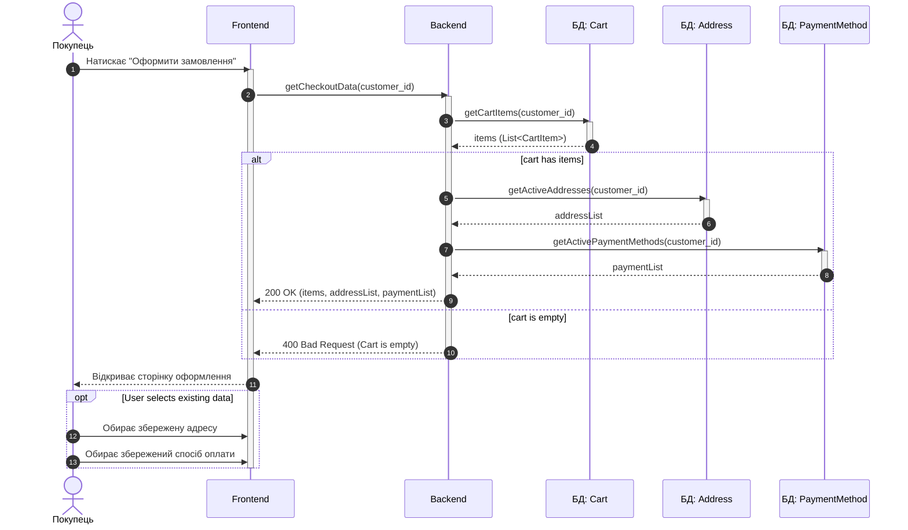
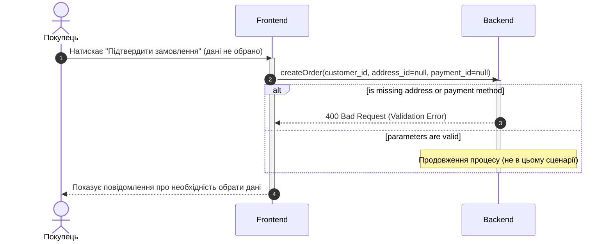
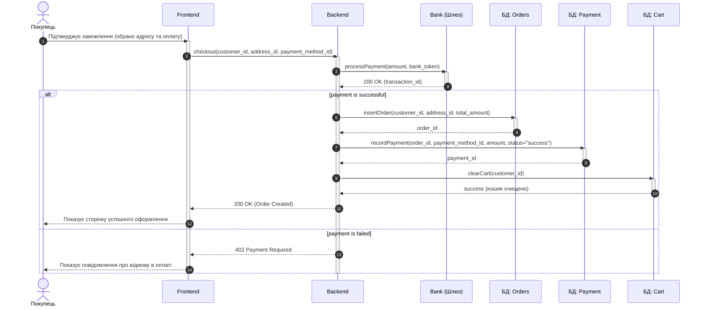

# Генерація Sequence-діаграм для US-2-3 (Оформлення замовлення)

**Мій запит:**
> Ти System Architect та експерт з Mermaid. Твоє завдання — згенерувати Sequence-діаграми для 4х Gherkin-сценаріїв (Use Case: Оформлення замовлення).
> ПРАВИЛА РОБОТИ (КРИТИЧНО ВАЖЛИВО):
>  Учасники повинні строго відповідати сутностям ER-моделі (наприклад, Customer, Address, PaymentMethod, Cart, Orders, Payment). Можеш додати Frontend (Браузер), Backend (Сервер) та зовнішній Bank (Платіжний шлюз). Жодних вигаданих таблиць.
> Методи: Використовуй реалістичні назви функцій ( getAddresses(), validatePayment(), clearCart()).
Фрагменти: Мінімум один комбінований фрагмент (alt, opt або loop) у КОЖНІЙ діаграмі.
> Activation bars (ЖОРСТКА ВИМОГА): Лінія життя (activate / deactivate) учасника, що працює поза фрагментом, має починатися ДО фрагмента і закінчуватися ПІСЛЯ нього. Жодних обривів, дублювань чи deactivate всередині окремих  гілок alt чи opt

**Результат від AI:**

**Для КП1:**

**Для КП2:**

**Для КП3:**

